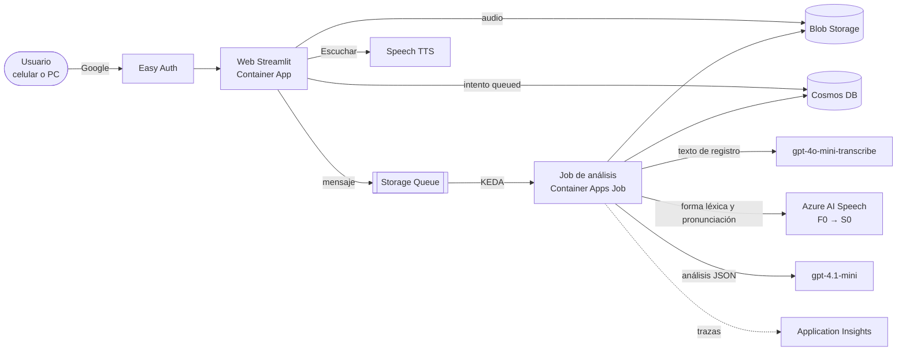

# speak2myTrainer

Entrenador de voz para practicar inglés hablado, pensado para preparar entrevistas. Grabas o subes una respuesta de 10 s a 10 min y recibes:

- **métricas de fluidez** calculadas en Python: palabras por minuto, muletillas por minuto, reinicios;
- **muletillas con su cita**: pausas de duda (*um*, *uh*), reinicios (*we build a… a system*) y muletillas léxicas (*like*, *basically*), separadas de los usos válidos;
- **errores gramaticales** con la corrección y una explicación en español;
- **pronunciación** opcional, con puntajes de precisión, fluidez y prosodia, y las palabras a practicar con sus sonidos débiles;
- una **versión mejorada** que puedes escuchar con voz neural, y que se difumina mientras grabas el siguiente intento;
- la **comparación** con tu intento anterior: qué corregiste, qué empeoró y cómo cambiaron las métricas.

> **Estado:** Fases 0 a 2 completas; Fase 3 (pulido para portafolio) en curso. Ver el [PRD](docs/PRD/) y las [decisiones de arquitectura](docs/adr/).

<!-- Video demo: pendiente. -->

## Arquitectura

Una sola imagen de Python corre en dos modos: la web de Streamlit, que solo recibe y encola, y un Container Apps Job, que analiza y se apaga. Ninguno tiene réplicas mínimas, así que sin uso no cuestan nada.



Pipeline del job por intento:

1. Convertir el audio a WAV de 16 kHz mono con ffmpeg (acepta lo que graba el navegador y las notas de voz del iPhone).
2. Transcribir en paralelo con `gpt-4o-mini-transcribe` (el texto que ve el usuario) y con Azure Speech (la forma léxica, que conserva *um/uh* y repeticiones).
3. Si se pidió, evaluar la pronunciación en una segunda pasada de Speech, filtrando las palabras que el reconocimiento entendió mal.
4. Contar hesitaciones y repeticiones en Python, y pedir al LLM las muletillas léxicas, la gramática, la versión mejorada y la comparación, con Structured Outputs. Cada cita del LLM se valida contra las transcripciones y se descarta si no aparece.
5. Calcular métricas y costo estimado, guardar el resultado y comprimir el audio a AAC.

El código es hexagonal (puertos y adaptadores): el dominio y los casos de uso no conocen Streamlit ni Azure, e `import-linter` lo verifica en CI. Cambiar de modelo, que se retiran en 2027, es escribir un adaptador.

```
src/speak2mytrainer/
  domain/        reglas puras: métricas, disfluencias, gramática, pronunciación, costo
  application/   casos de uso + ports.py (Protocols)
  adapters/      inbound (streamlit_app, worker_job) · outbound (Azure, ffmpeg, fakes)
  bootstrap.py   raíz de composición: elige adaptadores por entorno
```

## Decisiones

| ADR | Decisión |
| --- | --- |
| [0001](docs/adr/0001-arquitectura-hexagonal.md) | Arquitectura hexagonal pragmática, con fakes para cada puerto |
| [0002](docs/adr/0002-motor-de-transcripcion.md) | Transcripción híbrida: el texto del LLM para leer y la forma léxica de Speech como evidencia de muletillas |
| [0003](docs/adr/0003-modo-evaluacion-pronunciacion.md) | Pronunciación sin guion en una pasada aparte, porque en la misma pasada se perdía el 62% de las hesitaciones |
| [0004](docs/adr/0004-ui-streamlit-y-auth.md) | Streamlit con Easy Auth de Container Apps y Google |
| [0005](docs/adr/0005-observabilidad.md) | Application Insights con OpenTelemetry, sin llaves y sin datos personales |

Otros principios:
- **Sin llaves:** todo usa Entra ID (`DefaultAzureCredential`): identidad administrada en Azure y `az login` en local. GitHub Actions despliega con OIDC.
- **El LLM no calcula números:** duración, ritmo, conteos y costo los calcula Python.
- **Calidad medida:** un set de 50 casos con 0 falsos positivos como meta corre en CI cuando cambia el prompt o el modelo.

## Costos

Con unos 10 usuarios y 10 h de audio al mes, el costo ronda 8 USD/mes, con un tope de 15 USD con alertas. Casi todo es Azure AI Speech, porque la infraestructura queda en niveles gratuitos:
- Container Apps escala a cero.
- Cosmos DB usa su nivel gratuito.
- Las imágenes van en GHCR, no en ACR.
- Speech F0 cubre las primeras 5 h.

Cada intento guarda su costo estimado, y el panel de admin muestra el gasto del mes. Detalle en el [PRD](docs/PRD/).

## Desarrollo

```bash
uv sync --all-extras                          # Python 3.12, deps de desarrollo y extras azure + web
uv run pytest                                 # unitarios con fakes, sin Azure
uv run streamlit run src/speak2mytrainer/entrypoints/web.py   # la app completa en local, con fakes
uv run ruff check . && uv run ruff format --check .
uv run mypy
uv run lint-imports                           # regla de capas hexagonales
```

Con Azure:
- `uv run pytest -m integration` prueba los adaptadores reales.
- `uv run --all-extras python evals/run_eval.py` corre el set de evaluación con el LLM real.

Infraestructura en Bicep y despliegue: ver [`infra/README.md`](infra/README.md).
